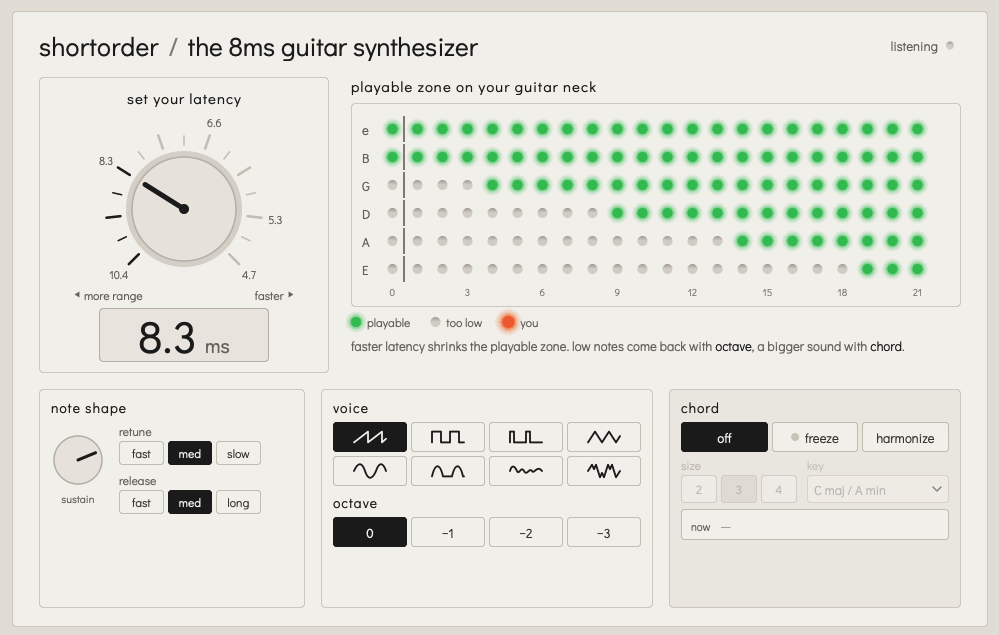

# ShortOrder

**The 8ms Guitar Synthesizer**, by Yacht Pockets.

## Author's note

Thank you for checking out my guitar synthesizer plugin, ShortOrder. I love guitar synthesizer pedals (the Electro-Harmonix Synth 9 pedal is currently in my main signal chain) but have always found them a bit hard to work with due to the latency at the low end. So I built ShortOrder to be very fast, and very playable. You start by setting your latency, with the tradeoff of losing some of the lower notes on your neck. Octaves and harmonizers get a big, full, and low sound back.

I hope you enjoy playing with ShortOrder as much as I enjoyed building it. Please [reach out](../../issues) and let me know what you think!



ShortOrder turns a guitar's pitch into a hard-snapped monophonic synth voice with a fixed, low latency that you set. It is a free, MIT-licensed plug-in for macOS (AU, VST3 and AAX for Pro Tools) with a standalone app.

**[Download the latest release](../../releases/latest)**

| Latency setting | Lowest note | Within a phrase | Note from silence (typical) |
|---|---|---|---|
| Slowest | G3 | 5.2 ms | ~12 ms |
| Default | B3 | 4.1 ms | ~9.5 ms |
| Fastest | A4 | 2.4 ms | ~7.5 ms |

Every playable note gets the same delay at a given setting. Notes below the lowest note are not tracked. To reach them, play higher and use Octave to drop the voice.

## The faceplate

- **Status (header):** `listening`, `tracking E4`, `too low – try octave` or `above board`.
- **Latency:** the large knob. Turn it right for less latency and a higher lowest note. It has 15 steps, one per semitone from G3 to A4, and shows the delay in ms.
- **Neck:** 21 frets of LEDs. Green frets play at the current setting. Orange shows the note you are playing (every position of it, since the plug-in cannot tell which string you're on). Blue shows Freeze's held notes. A ring marks a note below range, and an arrow marks one above the board.
- **Note Shape:**
  - **Sustain** (0–100%): how much of the guitar's natural fade the synth ignores while a note is detected.
  - **Retune** (Fast / Med / Slow): how quickly a note change glides to its new pitch.
  - **Release** (Fast / Med / Long): how long the last note holds after the guitar stops.
- **Voice:**
  - **Wave:** saw, square, NES lead, triangle, sine, half-sine, organ or folded.
  - **Octave:** 0, −1, −2 or −3.
- **Chord:**
  - **Freeze** holds your last 2–4 notes (set with **Size**) under the note you're playing. **HELD** lights while they hold.
  - **Harmonize** adds diatonic harmony in the **Key** you choose.
  - The box beside it shows the chord that's sounding.

A new pick within 100 ms of the last note glides in from that note.

## Install

Download from [Releases](../../releases/latest). Everything is signed and notarized.

**Installer:** open `ShortOrder-1.1.0-macOS.pkg`, click **Customize**, and choose the formats you want: AU, VST3, AAX or the standalone app.

**Zips:**

1. Unzip the zip for your format.
2. In Finder, press **Cmd + Shift + G** and go to the folder for your format:
   - AU: `/Library/Audio/Plug-Ins/Components`
   - VST3: `/Library/Audio/Plug-Ins/VST3`
   - AAX (Pro Tools): `/Library/Application Support/Avid/Audio/Plug-Ins`
   - Standalone: `/Applications`
3. Drag the plug-in or app into that folder.
4. Open your DAW, and rescan plug-ins if ShortOrder doesn't appear.

`ShortOrder-Install-Guide.md` on the release page has setup steps for Logic Pro, REAPER and the standalone app.

**Requirements:** macOS 11 or later on Apple silicon or Intel, and an audio interface with an instrument input.

**For the lowest total latency:**
- Set the interface buffer to 64 samples or lower. At 256 samples, the buffer alone adds about 11 ms.
- In Logic, turn on Low Latency Mode. Logic turns it off at every launch, so add its button to the control bar.
- Turn off direct or hardware monitoring on the interface.
- Use a clean, dry DI signal, with the guitar tuned to A440. ShortOrder snaps to the nearest semitone, so a string more than about 40 cents off can flip to the neighbouring note.

**Uninstall:** move whichever you installed to the Trash (Finder, **Cmd + Shift + G**, paste the path):

- `/Library/Audio/Plug-Ins/Components/ShortOrder.component`
- `/Library/Audio/Plug-Ins/VST3/ShortOrder.vst3`
- `/Library/Application Support/Avid/Audio/Plug-Ins/ShortOrder.aaxplugin`
- `/Applications/ShortOrder.app`

---

## How latency works

- **Monophonic on purpose.** A single-note detector needs to see about two cycles of the lowest note it allows. A polyphonic tracker has to separate several notes at once, which takes a longer look; software trackers typically measure 20–40 ms.
- **The window sets the floor.** The knob sets the detector's window, from 10.4 ms (G3) to 4.7 ms (A4) at 48 kHz. The synth plays on a timeline delayed by half a window (5.2 ms to 2.4 ms, which is what the knob shows), so the delay is the same for every note in range. Most guitar synths are pitch-dependent instead: fast on high notes and slow on low ones.
- **Note starts take longer.** Within a phrase (slides, legato, re-picks while a note sounds), the delay equals the setting. A note from silence starts later: about 9.5 ms after the pick at the default (about 12 ms at the slowest setting, about 7.5 ms at the fastest), because the first confident reading of a new note is centred half a window after the pick, and the voice then plays half a window behind. If that first reading lands on a neighbouring note, the voice jumps straight to the right one instead of sliding into it.
- **What's not counted.** These figures are detection latency only. The interface's round trip is usually about 3–6 ms at a 64-sample buffer.

The figures were measured offline on real DI takes.

## Signal path

```
input -> mono -> YIN pitch detector -> quantizer (hysteresis, glide) -> oscillator (x1, 1/2, 1/4, 1/8)
      -> 5 kHz low-pass -> level (envelope follower, Sustain, Dynamics) -> chord tones -> voice gate
      -> headroom gain -> safety clip -> output
```

- **Detector:** YIN with FFT autocorrelation, evaluated every 128 samples at 48 kHz, and capped at 1400 Hz.
- **Quantizer:** snaps to the nearest semitone with 11.25-cent hysteresis, then glides at the Retune speed.
- **Level:** follows the delayed input, so the synth's dynamics track your picking.
- **Protections:** a set of rules keeps decaying notes from sputtering, jumping octaves or retriggering. They cover the release grace, harmonic lock, mute detection, the fall lock and the range edges.
- **Waves:** band-limited (PolyBLEP / PolyBLAMP) and loudness-matched.
- **Headroom:** the output is held under −1 dB from the clip knee by a predicted-peak gain.

The DSP in `Source/DSP/` depends on nothing in JUCE except `juce::dsp::FFT`. The code uses `gtt` as its internal name.

## Build from source

Requirements: macOS, CMake, Xcode command-line tools, and JUCE 8.0.12 installed locally. CMake looks in `~/JUCE-installed`, or wherever `-DCMAKE_PREFIX_PATH` points. The AAX build also needs Avid's AAX SDK at `~/AAX_SDK`, which is not included.

```
./build-install.sh        # build AU, VST3, Standalone (and AAX if the SDK is present); ad hoc sign; install AU and VST3; run auval
./run-tests.sh            # offline DSP tests
./release.sh --dry-run    # the full release flow, unsigned, into dist/dry-run/
```

Signed releases use `./release.sh` with a local `signing.env`, copied from `signing.env.example`.

The full test suite and the golden renders use DI recordings that are not in this repository. The tests that need them report the missing files.

## Parameters

There are ten host parameters, frozen at 1.0. Their IDs, ranges and choice order will not change, and new parameters will be added only at the end.

`latency`, `sustain`, `retuneSpeed`, `release`, `wave`, `octave`, `chordType`, `chordSize`, `chordKey`, `bypass`

AU: `aufx ShOr Ypkt`. Bundle ID: `com.yachtpockets.shortorder`.

## Credits and license

Built by Duncan Wold with Claude Code. Duncan directed the design and did the play-testing on guitar. The code and tests were written with Claude Code.

MIT (`LICENSE`). Third-party components are listed in `THIRD-PARTY-NOTICES.md`: JUCE 8 (building from source needs a JUCE licence or the AGPLv3), the VST3 SDK and Didact Gothic (OFL 1.1).

ShortOrder and Yacht Pockets are names of Duncan Wold. The MIT license covers the code, not the names: forks must use a different name and plugin ID.
